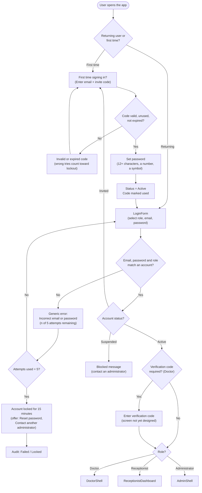
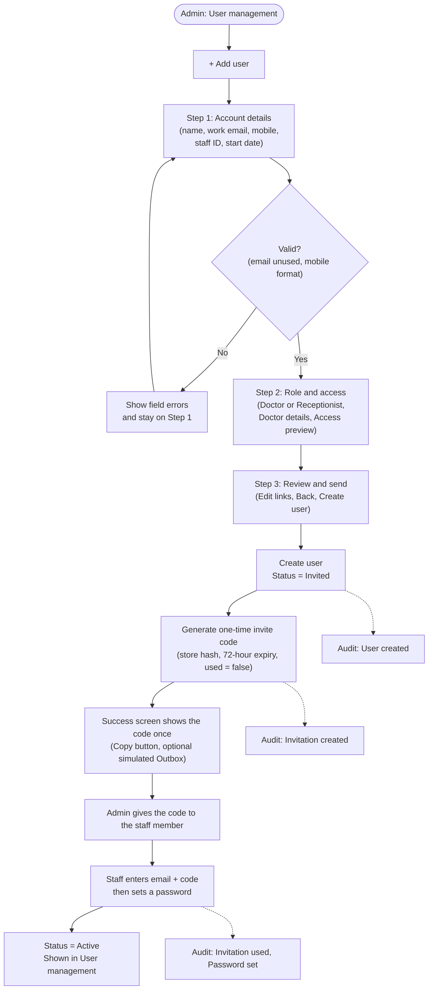
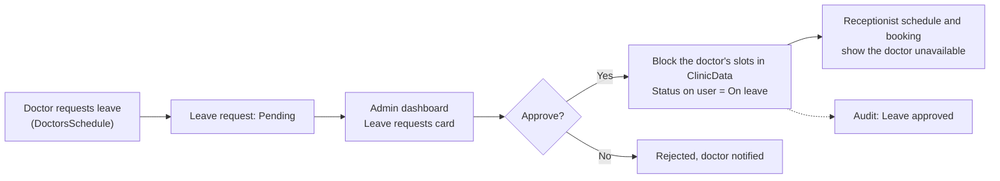
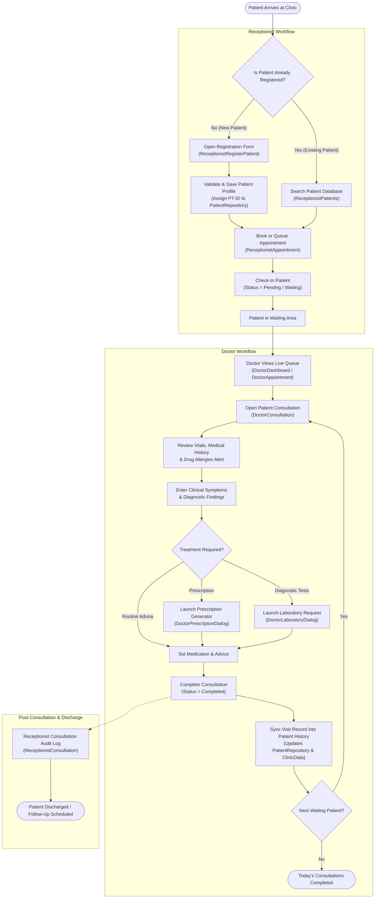
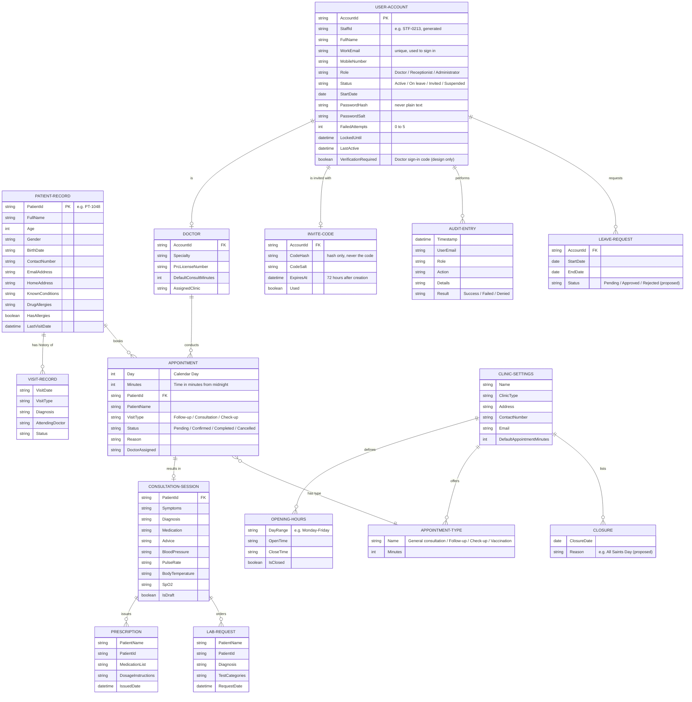

# Clinic Management System — Structure & Workflow Architecture (v2, adds Administrator)

This document specifies the structural flow, module hierarchy, data pipeline, and operational workflows of the **UCC Health Clinic Management System**, now with three roles: **Receptionist**, **Doctor**, and **Administrator**.

**Legend.** Items marked **(NEW)** were added for the Administrator part, based on the Figma admin flow (see `ADMIN_FLOW.md`). Class and screen names marked **(proposed)** are suggestions: confirm them against the real code. Everything else is carried over unchanged from v1.

---

## 1. High-Level System Architecture Flow

The application is structured into four layers: **Presentation (UI)**, **Navigation Shells**, **Shared Repositories and Services**, and the **Data Models**. (NEW) A security layer now sits in front: sign-in, lockout, invite codes, and the audit log.

```mermaid
flowchart TD
    subgraph Client["Client Entry Point"]
        Login["LoginForm\n(Role Selector: Receptionist / Doctor / Administrator)"]
        FirstTime["First-time sign-in (NEW)\n(Email + one-time invite code)"]
        SetPwd["Set password (NEW)\n(first sign-in)"]
        Locked["Account locked (NEW)\n(5 failed attempts, 15 minutes)"]
    end

    subgraph ShellLayer["Shell & Navigation Layer"]
        DoctorShell["DoctorShell\n(SidebarHandler & Tab Viewport)"]
        RecepShell["ReceptionistDashboard\n(Host Form & View Swapping)"]
        AdminShell["AdminShell (NEW, proposed)\n(Sidebar: Dashboard, User management,\nClinic settings, Audit log)"]
    end

    subgraph ViewsDoctor["Doctor Views & Dialogs"]
        DocDash["DoctorDashboard"]
        DocPatients["DoctorPatients"]
        DocPatientInfo["DoctorPatientInformation"]
        DocAppt["DoctorAppointment"]
        DocSched["DoctorsSchedule"]
        DocConsult["DoctorConsultation"]
        DocRx["DoctorPrescriptionDialog"]
        DocLab["DoctorLaboratoryDialog"]
        DocReports["DoctorReports"]
    end

    subgraph ViewsRecep["Receptionist Views & Dialogs"]
        RecDash["pnlDashboard"]
        RecPatients["ReceptionistPatients"]
        RecRegister["ReceptionistRegisterPatient"]
        RecPatientInfo["ReceptionistPatientInformation"]
        RecAppt["ReceptionistAppointment"]
        RecSched["ReceptionistDoctorSchedules"]
        RecConsultList["ReceptionistConsultation"]
        RecConsultDetail["ReceptionistConsultationDetail"]
        RecReports["ReceptionistClinicReports"]
    end

    subgraph ViewsAdmin["Administrator Views (NEW)"]
        AdmDash["AdminDashboard"]
        AdmUsers["UserManagement"]
        AdmAdd["AddUser wizard\n(Step 1 Account, Step 2 Role and access,\nStep 3 Review and send)"]
        AdmCode["InviteCodeSuccess\n(shows the one-time code once)"]
        AdmSettings["ClinicSettings"]
        AdmAudit["AuditLog"]
    end

    subgraph DataLayer["Shared Data & State Services"]
        PR["PatientRepository\n(Longitudinal Patient Records)"]
        CD["ClinicData\n(Appointments, Timetable Slots, Vitals)"]
        AR["AccountRepository (NEW, proposed)\n(Staff accounts, status, password hash,\ninvite codes, lockout counters)"]
        AL["AuditLogService (NEW, proposed)\n(Append-only activity log)"]
        CS["ClinicSettings (NEW, proposed)\n(Profile, opening hours,\nappointment types, closures)"]
    end

    subgraph DataModels["Domain Entities"]
        PI["PatientItem & VisitItem"]
        AI["AppointmentItem & SlotItem"]
        UA["UserAccount & InviteCode (NEW)"]
        AE["AuditEntry (NEW)"]
        SE["SettingsItem, OpeningHours,\nAppointmentType, Closure (NEW)"]
    end

    Login -->|"Role = Doctor"| DoctorShell
    Login -->|"Role = Receptionist"| RecepShell
    Login -->|"Role = Administrator"| AdminShell
    Login -.->|"Status = Invited"| FirstTime
    FirstTime --> SetPwd
    SetPwd -->|"Account becomes Active"| Login
    Login -.->|"5 failed attempts"| Locked

    DoctorShell --> DocDash
    DoctorShell --> DocPatients
    DoctorShell --> DocPatientInfo
    DoctorShell --> DocAppt
    DoctorShell --> DocSched
    DoctorShell --> DocConsult
    DoctorShell --> DocReports

    DocConsult -.->|"Modal Dialog"| DocRx
    DocConsult -.->|"Modal Dialog"| DocLab

    RecepShell --> RecDash
    RecepShell --> RecPatients
    RecepShell --> RecRegister
    RecepShell --> RecPatientInfo
    RecepShell --> RecAppt
    RecepShell --> RecSched
    RecepShell --> RecConsultList
    RecepShell --> RecConsultDetail
    RecepShell --> RecReports

    AdminShell --> AdmDash
    AdminShell --> AdmUsers
    AdminShell --> AdmSettings
    AdminShell --> AdmAudit
    AdmUsers --> AdmAdd
    AdmAdd --> AdmCode

    DocDash & DocPatients & DocPatientInfo & DocConsult --> PR
    DocDash & DocAppt & DocSched & DocConsult --> CD

    RecPatients & RecRegister & RecPatientInfo --> PR
    RecDash & RecAppt & RecSched & RecConsultList --> CD

    AdmDash & AdmUsers & AdmAdd & AdmCode --> AR
    AdmDash --> CD
    AdmSettings --> CS
    AdmAudit --> AL
    CS -->|"Opening hours and appointment types\ndrive booking and slots"| CD

    Login & FirstTime & SetPwd --> AR
    Login & AdmAdd & AdmUsers & AdmSettings --> AL
    DocConsult & RecAppt & RecRegister -.->|"Key actions logged"| AL

    PR --- PI
    CD --- AI
    AR --- UA
    AL --- AE
    CS --- SE
```

---

## 2. Sign-In, Lockout and First-Time Setup Flow (NEW)

Covers all three roles. Role comes from the **account**, not from the selector. A role mismatch fails with the same generic error as a wrong password.

---

## 3. Administrator Workflows (NEW)

### 3.1 Adding a staff member (one-time invite code)

### 3.2 Other administrator tasks

- **Manage accounts (User management):** search and filter by role and status; Edit; Reset password; Unlock; Suspend or Reactivate; Resend invite (new code replaces the old one). All of these write audit entries.
- **Clinic settings:** edit clinic profile, opening hours, appointment types and closures (holidays). Saved settings feed booking and slot generation for the receptionist and doctor.
- **Audit log:** read-only, filter by user, action and date range, Export CSV (the export itself is logged).
- **Boundary:** the administrator manages accounts and settings only. Opening patient records or clinical notes is blocked and logged as **Denied**.

### 3.3 Leave requests (NEW, proposed: the Figma shows only a count)

---

## 4. End-to-End Clinical Operational Workflow

This diagram outlines how a patient moves through the clinic, from registration and check-in by the Receptionist, to examination and treatment by the Doctor. (Unchanged from v1.)

---

## 5. UI Navigation & Screen Hierarchy

### Doctor Navigation Flow
- **`DoctorShell`** acts as the parent container with a persistent sidebar handled by **`SidebarHandler`**:
  - **Dashboard (`DoctorDashboard`)**: Displays metrics (*Today's Appointments*, *Waiting Now*, *Completed*, *Cancelled*), schedule feed, quick actions, recent patient list.
  - **Patients (`DoctorPatients`)**: Searchable directory. Clicking any patient row navigates directly to **`DoctorPatientInformation`** with the target `PatientId`.
  - **Patient Details (`DoctorPatientInformation`)**: Full medical record, demographics, drug allergy warning card, past visit timeline, and upcoming appointments. Contains a back button returning to **`DoctorPatients`**.
  - **Appointments (`DoctorAppointment`)**: Day tabs (Day 21–25), doctor selector, timeline view with patient status pills (*Pending*, *Completed*).
  - **Schedule (`DoctorsSchedule`)**: Comprehensive weekly scheduling grid and roster management. (NEW, proposed: a **Request leave** action.)
  - **Consultation (`DoctorConsultation`)**: Live session interface. Integrates vital signs card, known conditions banner, symptoms, diagnosis, treatment inputs, and triggers:
    - **`DoctorPrescriptionDialog`**: Printable prescription sheet.
    - **`DoctorLaboratoryDialog`**: Printable laboratory requisition sheet.
  - **Reports (`DoctorReports`)**: Doctor-level performance, completed consultation tallies, and patient volume statistics.

### Receptionist Navigation Flow
- **`ReceptionistDashboard`** operates as a dynamic container hosting sub-views inside `mainScreen`:
  - **Dashboard (`pnlDashboard`)**: Daily throughput counters, today's waiting schedule, quick access buttons.
  - **Patients (`ReceptionistPatients`)**: Full directory with filtering. Triggers `Register Patient` or opens `ReceptionistPatientInformation`.
  - **Register Patient (`ReceptionistRegisterPatient`)**: Input form with validation for demographics, contact, address, and initial medical conditions.
  - **Patient Profile (`ReceptionistPatientInformation`)**: Receptionist view of patient information, booking actions, and history.
  - **Appointments (`ReceptionistAppointment`)**: Comprehensive booking and check-in grid. Allows status changes (*Pending*, *Confirmed*, *Completed*, *Cancelled*).
  - **Doctor Schedules (`ReceptionistDoctorSchedules`)**: Doctor on-duty calendar, consultation hour blocks, and room assignments.
  - **Consultation Log (`ReceptionistConsultation`)**: Clinic-wide consultation records log. Clicking an item navigates to **`ReceptionistConsultationDetail`**.
  - **Consultation Detail (`ReceptionistConsultationDetail`)**: Comprehensive visit review showing consultation summary and vitals.
  - **Clinic Reports (`ReceptionistClinicReports`)**: Clinic-wide census, visit types breakdown, and operational summaries.

### Administrator Navigation Flow (NEW)
- **`AdminShell` (proposed)** has a persistent sidebar with four items: Dashboard, User management, Clinic settings, Audit log, and a user card (name and role "Clinic Administrator").
  - **Dashboard (`AdminDashboard`)**: Stat cards (*Active staff*, *Appointments today*, *Leave requests*, *Accounts to review*), Recent activity feed, Staff by role bars, **+ Add user**.
  - **User management (`UserManagement`)**: Search, role and status filters, accounts table (Name, Email, Role, Status, Last active, Edit), Role permissions card. Statuses: *Active*, *On leave*, *Invited*, *Suspended*. Opens the **Add user** wizard.
  - **Add user wizard**: Step 1 Account details (with validation errors), Step 2 Role and access (Doctor or Receptionist, Doctor details, Access preview), Step 3 Review and send, then the **invite code success** screen.
  - **Clinic settings (`ClinicSettings`)**: Clinic profile, opening hours, appointment types, Save changes. (NEW, proposed: closures/holidays.)
  - **Audit log (`AuditLog`)**: Read-only activity table (Time, User, Role, Action, Details, Result: *Success*, *Failed*, *Denied*), filters, **Export CSV**.
- **Sign-in screens for all roles:** Sign in, Sign in error, Account locked, First-time sign-in (invite code), Set password. (Verification code and Forgot/Reset password screens are not yet designed.)

---

## 6. Data Flow & Entity Relationship

---

## 7. Role Permissions (NEW)

Based on the Figma Role permissions card, the Access preview, and the audit log. A question mark means the design does not decide it yet.

| Capability | Doctor | Receptionist | Administrator |
|---|---|---|---|
| View and edit patient records | Yes | Register and view (per screens) | No |
| Write consultation notes | Yes | No | No (blocked and logged as Denied) |
| Book and manage appointments | View own | Yes | No |
| Own schedule | Yes | No | No |
| See all doctor schedules | No | Yes | ? |
| Reports | Doctor reports | Clinic reports | ? |
| Manage user accounts | No | No | Yes |
| Clinic settings | No | No | Yes |
| View audit log | No | No | Yes |
| Approve leave requests | No | No | Yes (proposed) |

---

## 8. Open Decisions

1. Can a user with status **On leave** sign in? (Suspended is blocked; On leave is not defined.)
2. Is the doctor **verification code** at every sign-in being built? It needs a screen.
3. Where do **leave requests** originate? The proposed answer is a "Request leave" action in `DoctorsSchedule`.
4. Does the administrator get **reports** or the doctor schedules view?
5. Appointment type names: unify the Settings list (General consultation, Follow-up, Check-up, Vaccination) with `VisitType` (Follow-up, Consultation, Check-up).
6. **Persistence:** accounts, invite codes, the audit log, and settings must survive closing the app. v1 repositories are in memory.
7. Can an administrator create another administrator? Step 2 only offers Doctor and Receptionist.
8. Date model: appointments store only Day and Minutes (no month or year), and the doctor appointment screen has fixed day tabs.
9. Status vocabulary: unify "Waiting" with Pending / Confirmed / Completed / Cancelled.
