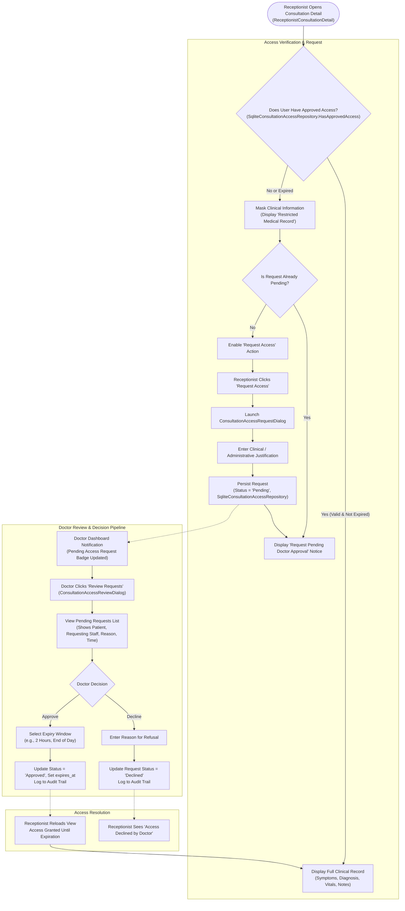
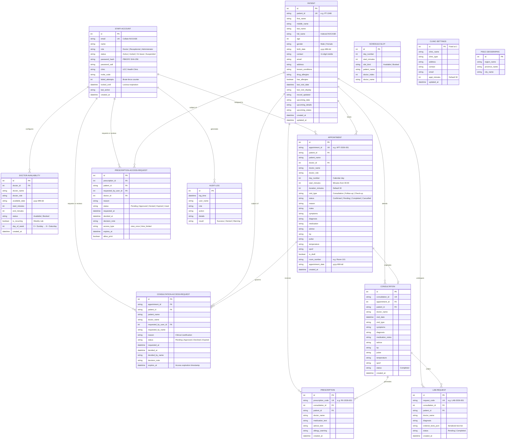
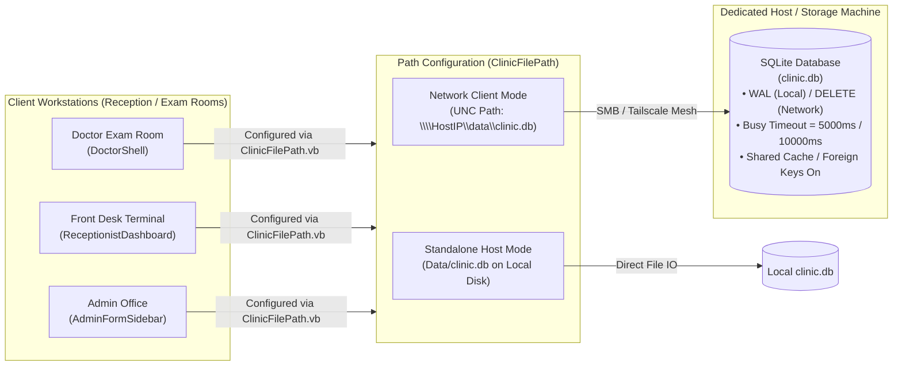

# Clinic Management System — Structure & Workflow Architecture

This document specifies the structural flow, module hierarchy, data pipeline, and operational workflows of the **UCC Health Clinic Management System**.

---

## 1. High-Level System Architecture Flow

The application is structured into five distinct layers:
1. **Authentication & Connection Entry**: Credential-based login, first-time user invite activation, password recovery assistance, and network/local database connection configuration.
2. **Navigation Shells**: Role-specific master containers (`DoctorShell`, `ReceptionistDashboard`, `AdminFormSidebar`) managing sidebar navigation, user sessions, and sub-view embedding.
3. **Presentation & UI Views**: Role-scoped views, wizard forms, and interactive modal dialogs for clinical and administrative tasks.
4. **Data Access & Privacy Layer**: 11 dedicated SQLite repositories, access request/review governance for privacy compliance, and static facade stores providing cached in-memory access and event notifications.
5. **Persistent Storage Engine**: ACID SQLite relational database (`clinic.db`) with schema initialization, automatic data migrations, and PSGC geographic seeding.

```mermaid
flowchart TD
    subgraph Client["Authentication & Connection Layer"]
        Login["LoginForm\n(Credential Auth & Auto Role Detection)"]
        FirstTime["FirstTimeSignInDialog\n(Invite Code Activation)"]
        ForgotPwd["ForgotPasswordDialog\n(Admin Contact & Assistance)"]
        DbConfig["ClinicFilePath\n(Centralized Database Path Helper)"]
    end

    subgraph ShellLayer["Shell & Navigation Layer"]
        DoctorShell["DoctorShell\n(SidebarHandler, Cached Views & Return Stack)"]
        RecepShell["ReceptionistDashboard\n(Host Form, Active Counters & View Swapping)"]
        AdminShell["AdminFormSidebar\n(SidebarHandler & Page Host with Dirty Guard)"]
    end

    subgraph ViewsAdmin["Admin Views & Wizards"]
        AdminDash["AdminDashboard\n(Live Metrics & Quick Roster)"]
        AdminUsers["UserManagement\n(Search, Role & Status Filters)"]
        AdminAddUser["AddUser\n(3-Step User Creation Wizard)"]
        AdminInvite["InviteCodeDialog\n(Generated Token Display)"]
        AdminEditUser["EditUserDialog\n(Role, Status & Clinic Editor)"]
        AdminSettings["ClinicSettings\n(Profile, Hours & Duration)"]
        AdminAudit["AuditLog\n(Chronological System Log)"]
    end

    subgraph ViewsDoctor["Doctor Views & Dialogs"]
        DocDash["DoctorDashboard\n(Queue KPI & Pending Access Requests)"]
        DocPatients["DoctorPatients\n(Directory & Instant Search)"]
        DocPatientInfo["DoctorPatientInformation\n(Full Chart, Timeline & Allergies)"]
        DocAppt["DoctorAppointment\n(Day Tabs & Patient Status Filter)"]
        DocSched["DoctorsSchedule\n(ClinicCalendarView & Grid)"]
        DocAddAvail["DoctorAddAvailabilityDialog\n(Slot / Recurring Setup)"]
        DocSlotDetail["AvailabilitySlotDetailsDialog\n(Slot Inspection / Removal)"]
        DocEventDetail["CalendarEventDetailsDialog\n(Appt View & Direct Consult Launch)"]
        DocConsult["DoctorConsultation\n(Live Vitals, Notes & Prescribing)"]
        DocRx["DoctorPrescriptionDialog\n(Printable Prescription Sheet)"]
        DocLab["DoctorLaboratoryDialog\n(Requisition Order Sheet)"]
        DocReports["DoctorReports\n(Volume & Diagnosis Tallies)"]
        DocDrillDown["DoctorReportsDrillDownDialog\n(Itemized Case Breakdown)"]
    end

    subgraph ViewsRecep["Receptionist Views & Dialogs"]
        RecDash["pnlDashboard\n(Today's Queue & Quick Check-In)"]
        RecPatients["ReceptionistPatients\n(Directory & Register CTA)"]
        RecRegister["ReceptionistRegisterPatient\n(PSGC Geo Lookup & Duplicate Guard)"]
        RecPatientInfo["ReceptionistPatientInformation\n(Profile & Quick Book CTA)"]
        RecAppt["ReceptionistAppointment\n(Day Filter, Status Dropdown & Actions)"]
        RecBookAppt["ReceptionistBookAppointmentDialog\n(New Booking / Reschedule Modal)"]
        RecSched["ReceptionistDoctorSchedules\n(Doctor Rosters & Availability Viewer)"]
        RecConsultList["ReceptionistConsultation\n(Clinic Visit Ledger)"]
        RecConsultDetail["ReceptionistConsultationDetail\n(Visit Review & Privacy Guard)"]
        RecReports["ReceptionistClinicReports\n(Census, Visit Types & Doctor Stats)"]
    end

    subgraph PrivacyLayer["Privacy & Access Control Subsystem"]
        ReqAccess["ConsultationAccessRequestDialog\n(Receptionist Submits Access Justification)"]
        ReviewAccess["ConsultationAccessReviewDialog\n(Doctor Approves / Denies Access)"]
        ReviewRxAccess["PrescriptionAccessReviewDialog\n(Doctor Approves / Denies Rx Printing)"]
    end

    subgraph Facades["Static Bridge & Store Facades"]
        CD["ClinicData\n(Appointments, Realtime Notifications)"]
        PR["PatientRepository\n(Patient Profiles & Search)"]
        SS["StaffStore\n(Staff Directory & Lockout Status)"]
        AS["AuditStore\n(Centralized Audit Logging)"]
        CP["ClinicProfile\n(Clinic Profile Configuration)"]
    end

    subgraph Repositories["SQLite Repository Layer"]
        RepoAppt["SqliteAppointmentRepository"]
        RepoPatient["SqlitePatientRepository"]
        RepoConsult["SqliteConsultationRepository"]
        RepoStaff["SqliteStaffRepository"]
        RepoAudit["SqliteAuditRepository"]
        RepoSettings["SqliteClinicSettingsRepository"]
        RepoAvail["SqliteAvailabilityRepository"]
        RepoConsultAccess["SqliteConsultationAccessRepository"]
        RepoRxAccess["SqlitePrescriptionAccessRepository"]
        RepoReports["SqliteReportsRepository"]
        RepoGeo["SqliteGeoRepository (PSGC)"]
    end

    subgraph Database["Relational Database Engine"]
        SqliteDB[("SQLite Database\n(clinic.db / WAL Mode)")]
    end

    %% Auth & Entry Connections
    Login -.->|"Configure Network Path"| DbConfig
    Login -.->|"Activate with Token"| FirstTime
    Login -.->|"Password Help"| ForgotPwd
    Login -->|"Role = Administrator"| AdminShell
    Login -->|"Role = Doctor"| DoctorShell
    Login -->|"Role = Receptionist"| RecepShell

    %% Admin Shell Connections
    AdminShell --> AdminDash
    AdminShell --> AdminUsers
    AdminShell --> AdminSettings
    AdminShell --> AdminAudit
    AdminDash -.->|"Quick Add"| AdminAddUser
    AdminUsers -.->|"Add User"| AdminAddUser
    AdminUsers -.->|"Edit User"| AdminEditUser
    AdminAddUser -.->|"Show Code"| AdminInvite

    %% Doctor Shell Connections
    DoctorShell --> DocDash
    DoctorShell --> DocPatients
    DoctorShell --> DocPatientInfo
    DoctorShell --> DocAppt
    DoctorShell --> DocSched
    DoctorShell --> DocConsult
    DoctorShell --> DocReports
    DocSched -.->|"Add Availability"| DocAddAvail
    DocSched -.->|"Inspect Slot"| DocSlotDetail
    DocSched -.->|"Click Event"| DocEventDetail
    DocEventDetail -.->|"Direct Launch"| DocConsult
    DocConsult -.->|"Prescribe"| DocRx
    DocConsult -.->|"Order Lab"| DocLab
    DocReports -.->|"Drill Down"| DocDrillDown
    DocDash -.->|"Review Requests"| ReviewAccess
    DocDash -.->|"Review Rx Requests"| ReviewRxAccess

    %% Receptionist Shell Connections
    RecepShell --> RecDash
    RecepShell --> RecPatients
    RecepShell --> RecRegister
    RecepShell --> RecPatientInfo
    RecepShell --> RecAppt
    RecepShell --> RecSched
    RecepShell --> RecConsultList
    RecepShell --> RecConsultDetail
    RecepShell --> RecReports
    RecDash -.->|"Quick Book"| RecBookAppt
    RecAppt -.->|"Book / Reschedule"| RecBookAppt
    RecPatientInfo -.->|"Book"| RecBookAppt
    RecConsultDetail -.->|"Restricted Record"| ReqAccess
    RecSched -.->|"Inspect Appt"| DocEventDetail
    RecSched -.->|"Inspect Slot"| DocSlotDetail

    %% Privacy Layer Linkages
    ReqAccess ==> RepoConsultAccess
    ReviewAccess ==> RepoConsultAccess
    ReviewRxAccess ==> RepoRxAccess

    %% View to Facade / Repo Connections
    AdminUsers & AdminDash --> SS
    AdminSettings --> CP
    AdminAudit --> AS
    DocPatients & RecPatients & RecRegister & DocPatientInfo & RecPatientInfo --> PR
    DocDash & DocAppt & RecDash & RecAppt & DocSched & RecSched --> CD
    DocConsult & RecConsultList & RecConsultDetail --> RepoConsult
    DocReports & RecReports --> RepoReports
    RecRegister --> RepoGeo
    DocSched & RecSched --> RepoAvail

    %% Facade to Repositories
    CD --> RepoAppt
    PR --> RepoPatient
    SS --> RepoStaff
    AS --> RepoAudit
    CP --> RepoSettings

    %% Repositories to Database
    RepoAppt & RepoPatient & RepoConsult & RepoStaff & RepoAudit & RepoSettings & RepoAvail & RepoConsultAccess & RepoRxAccess & RepoReports & RepoGeo --> SqliteDB
```

---

## 2. End-to-End Clinical Operational Workflows

### 2.1 Patient Registration, Booking, Check-In & Consultation

This diagram details the comprehensive lifecycle of a patient visit: from initial demographic registration with PSGC geographic verification and appointment booking with conflict checking, to waiting queue check-in, physician consultation, and prescription/laboratory ordering.

```mermaid
flowchart TD
    Start(["Patient Arrives at Clinic"]) --> CheckStatus{"Is Patient Already Registered?"}

    %% Receptionist Registration & Verification
    subgraph ReceptionistPhase["Receptionist Workflow"]
        CheckStatus -->|"No (New Patient)"| RegForm["Open Registration Form\n(ReceptionistRegisterPatient)"]
        RegForm --> PSGC["Lookup Region / Province / City\n(SqliteGeoRepository)"]
        PSGC --> DupeCheck{"Duplicate Check\n(Phone or Name + DOB)"}
        DupeCheck -->|"Found Duplicate"| PromptDupe["Display Warning & Offer Existing Profile"]
        DupeCheck -->|"Unique"| SavePatient["Save Patient Profile\n(Auto-assigns PT-ID via SqlitePatientRepository)"]
        PromptDupe --> SearchPatient

        CheckStatus -->|"Yes (Existing Patient)"| SearchPatient["Search Patient Database\n(ReceptionistPatients)"]
        
        SavePatient --> BookDecision{"Book Appointment Now?"}
        SearchPatient --> BookDecision
        BookDecision -->|"Yes"| OpenBooking["Open Booking Dialog\n(ReceptionistBookAppointmentDialog)"]
        BookDecision -->|"No (Walk-in Direct)"| CheckInDirect["Create Immediate Pending Appointment"]

        OpenBooking --> CheckConflicts{"Check Doctor Availability\n& Overlapping Slots"}
        CheckConflicts -->|"Conflict Found"| ResolveConflict["Alert Receptionist & Pick Alternative Slot"]
        ResolveConflict --> OpenBooking
        CheckConflicts -->|"No Conflict"| SaveAppt["Persist Appointment\n(SqliteAppointmentRepository)"]
        SaveAppt --> ApptBooked["Appointment Scheduled (Confirmed)"]

        ApptBooked --> PatientArrival{"Patient Present Today?"}
        PatientArrival -->|"Yes"| ActionCheckIn["Receptionist Clicks Check-In\n(ReceptionistDashboard / ReceptionistAppointment)"]
        CheckInDirect --> ActionCheckIn
        ActionCheckIn --> SetPending["Update Status = 'Pending'\nAppend Timestamp Note & Audit Log"]
        SetPending --> WaitingQueue["Patient In Waiting Area Queue"]
    end

    %% Doctor Examination & Care
    subgraph DoctorPhase["Doctor Clinical Workflow"]
        WaitingQueue --> DocAlert["Doctor Views Live Waiting Queue\n(DoctorDashboard / DoctorAppointment)"]
        DocAlert --> SelectPatient["Select Patient for Consultation\n(Click 'Consult' or Calendar Event)"]
        SelectPatient --> OpenSession["Launch DoctorConsultation Session\n(Loads Chart & History)"]
        
        OpenSession --> ReviewAllergies{"Has Drug Allergies?"}
        ReviewAllergies -->|"Yes"| AlertBanner["Display High-Visibility Allergy Banner"]
        ReviewAllergies -->|"No"| RecordVitals["Record Vital Signs\n(BP, Pulse, Temp, SpO2)"]
        AlertBanner --> RecordVitals

        RecordVitals --> ClinicalExam["Enter Symptoms, Physical Exam\n& Provisional / Final Diagnosis"]
        ClinicalExam --> CareDecisions{"Care & Orders Required?"}

        CareDecisions -->|"Prescription Needed"| OpenRxDialog["Launch DoctorPrescriptionDialog\n(Draft Medications, Dosages & Sig)"]
        CareDecisions -->|"Lab Tests Needed"| OpenLabDialog["Launch DoctorLaboratoryDialog\n(Select Hematology, Urinalysis, Imaging)"]
        CareDecisions -->|"Clinical Advice Only"| FinalizeNotes["Enter Follow-Up Instructions & Advice"]

        OpenRxDialog --> SaveRx["Persist Prescription\n(prescriptions table)"] --> FinalizeNotes
        OpenLabDialog --> SaveLab["Persist Lab Requisition\n(lab_requests table)"] --> FinalizeNotes

        FinalizeNotes --> SaveConsultation["Complete Consultation\n(SqliteConsultationRepository.SaveConsultation)"]
        SaveConsultation --> UpdateAppt["Mark Appointment as 'Completed'\nSync Patient LastVisitDate"]
        UpdateAppt --> AuditConsult["Record Consultation Audit Entry\n(AuditStore.Log)"]
        AuditConsult --> NextWaitCheck{"Remaining Waiting Patients?"}
        NextWaitCheck -->|"Yes"| SelectPatient
        NextWaitCheck -->|"No"| ConsultsFinished(["Doctor Finished Live Queue"])
    end

    %% Post-Consultation Receptionist Phase
    subgraph PostConsultPhase["Post-Consultation & Discharge"]
        UpdateAppt -.-> RefreshRecep["Receptionist Dashboard Refreshed\n(Counter Incremented, Status: Completed)"]
        RefreshRecep --> PatientDischarge(["Patient Provided Discharge Paperwork / Next Appt Scheduled"])
    end
```

---

### 2.2 Privacy & Confidentiality Access Control Workflow

The system enforces strict medical confidentiality: clinical consultation records and prescription details are protected from unauthorized viewing by default. Receptionists requiring access to past consultation records must submit an access request with clinical justification, which the attending doctor reviews and approves with a time-limited expiration window.

---

## 3. UI Navigation & Screen Hierarchy

### 3.1 Authentication & System Configuration Flow
- **`LoginForm`**: Primary entry point. Accepts email and password. Automatically verifies credentials against `staff_accounts`, evaluates brute-force lockout status (5 failed attempts lock the account for 15 minutes), checks account status (`Active`, `Invited`, `Suspended`), determines user role (`Administrator`, `Doctor`, `Receptionist`), updates session via `CurrentUser`, and opens the appropriate shell.
  - **`ClinicFilePath`**: Central helper managing the active SQLite database path. Defaults to local `Data\clinic.db` for the host machine, or allows setting a UNC network path (`\\<HostIP>\data\clinic.db`) for a secondary workstation or doctor room across local Wi-Fi or Tailscale.
  - **`FirstTimeSignInDialog`**: Onboarding dialog for invited staff. Staff enter their assigned invite code (e.g., `UCC-DOC-4821`), system validates against `staff_accounts`, and prompts the user to set their password.
  - **`ForgotPasswordDialog`**: Displays official clinic administrative contact details and instructions for account unlock/reset.

---

### 3.2 Doctor Navigation Flow
- **`DoctorShell`**: Master shell managing persistent sidebar navigation, session indicators, and cached view swapping:
  - **Dashboard (`DoctorDashboard`)**:
    - Real-time KPI summary (*Today's Appointments*, *Waiting Now*, *Completed*, *Cancelled*).
    - Today's appointment feed with status action buttons.
    - Quick actions: Schedule appointment, open consultation.
    - Pending access request counter badge triggering **`ConsultationAccessReviewDialog`** and **`PrescriptionAccessReviewDialog`**.
  - **Patients (`DoctorPatients`)**: Searchable patient directory with instant search filtering. Clicking any row navigates to **`DoctorPatientInformation`** with parameter `(patientId, returnTo:=DoctorTab.Patients)`.
  - **Patient Medical Chart (`DoctorPatientInformation`)**: Complete longitudinal record displaying demographics, drug allergy warning banner, medical history, past visit timeline, and upcoming appointments. Context-aware back button returns to the calling view (`DoctorPatients` or `DoctorConsultation`).
  - **Appointments (`DoctorAppointment`)**: Calendar day tabs, status dropdown filters, patient details card, and one-click action to initiate consultation.
  - **Schedule & Availability (`DoctorsSchedule`)**: Weekly scheduling canvas using `ClinicCalendarView`:
    - **`DoctorAddAvailabilityDialog`**: Modal for creating new availability blocks (date-specific or recurring weekly day-of-week, start/end minutes, doctor assignment) with conflict detection.
    - **`AvailabilitySlotDetailsDialog`**: Modal for inspecting or deleting configured availability blocks.
    - **`CalendarEventDetailsDialog`**: Modal displaying appointment details with direct *"Launch Consultation"* button.
  - **Consultation Session (`DoctorConsultation`)**: Live examination interface:
    - Real-time patient information and vital signs input card (BP, Pulse, Body Temp, SpO2).
    - High-visibility drug allergy warnings.
    - Clinical notes, symptoms, and diagnosis entry fields.
    - **`DoctorPrescriptionDialog`**: Printable prescription sheet generator with medication list, dosages, and instructions.
    - **`DoctorLaboratoryDialog`**: Printable diagnostic request order generator (Hematology, Clinical Microscopy, Blood Chemistry, Imaging).
  - **Doctor Reports (`DoctorReports`)**: Doctor-specific analytics, completed consultation counts, and visit type distribution:
    - **`DoctorReportsDrillDownDialog`**: Modal breaking down chart categories into itemized patient case lists.

---

### 3.3 Receptionist Navigation Flow
- **`ReceptionistDashboard`**: Host form containing persistent sidebar and primary workspace:
  - **Dashboard (`pnlDashboard`)**: Throughput counters, daily schedule list, fast check-in action (marks appointment as *Pending* with arrival time note), and quick booking shortcuts.
  - **Patients Directory (`ReceptionistPatients`)**: Full searchable patient directory. Contains button to open **`ReceptionistRegisterPatient`** or opens **`ReceptionistPatientInformation`** on row click.
  - **Register Patient (`ReceptionistRegisterPatient`)**: Complete patient registration form:
    - Philippine Standard Geographic Code (**PSGC**) cascaded dropdowns (Region $\rightarrow$ Province $\rightarrow$ City) via `SqliteGeoRepository`.
    - Duplicate detection engine checking existing contact number or Full Name + Date of Birth.
  - **Patient Profile (`ReceptionistPatientInformation`)**: Receptionist view of demographic info, quick booking button triggering **`ReceptionistBookAppointmentDialog`**, and past visit ledger.
  - **Appointment Management (`ReceptionistAppointment`)**: Full booking and schedule management view:
    - Date picker and status filter tabs (*All*, *Confirmed*, *Pending*, *Completed*, *Cancelled*).
    - **`ReceptionistBookAppointmentDialog`**: Modal for scheduling new appointments or rescheduling existing appointments. Validates doctor availability and warns against double-booking.
  - **Doctor Schedules (`ReceptionistDoctorSchedules`)**: Multi-doctor weekly timetable and availability grid. Clicking appointments launches **`CalendarEventDetailsDialog`**; clicking open blocks launches **`AvailabilitySlotDetailsDialog`**.
  - **Consultation Audit Ledger (`ReceptionistConsultation`)**: Clinic-wide list of historical visits. Clicking any record opens **`ReceptionistConsultationDetail`**.
  - **Consultation Detail (`ReceptionistConsultationDetail`)**: Comprehensive visit review:
    - Automatically checks `SqliteConsultationAccessRepository.HasApprovedAccess`.
    - If unapproved, masks confidential clinical notes and displays request action.
    - Launches **`ConsultationAccessRequestDialog`** to request doctor authorization.
  - **Clinic Reports (`ReceptionistClinicReports`)**: Clinic-wide operational metrics, daily census, visit categories breakdown, and provider workload distribution.

---

### 3.4 Administrator Navigation Flow
- **`AdminFormSidebar`**: Master shell managing administrative sections with dirty wizard leave confirmation safeguards:
  - **Dashboard (`AdminDashboard`)**: Overview of active staff accounts, role breakdown, recent audit entries, and clinic profile summary.
  - **User Management (`UserManagement`)**: Staff directory with search, role filters (*All*, *Doctor*, *Receptionist*, *Administrator*), and status filters (*Active*, *Invited*, *On leave*, *Suspended*):
    - **`AddUser`**: 3-step wizard (Staff Details $\rightarrow$ Credentials & Roles $\rightarrow$ Confirmation).
    - **`InviteCodeDialog`**: Modal displaying generated invite code (e.g., `UCC-REC-9182`) with one-click clipboard copy.
    - **`EditUserDialog`**: Modal for editing existing staff accounts (role, account status, clinic assignment).
  - **Clinic Settings (`ClinicSettings`)**: Clinic identity and operational settings editor (Clinic Name, Practice Type, Physical Address, Contact Phone, Official Email, Default Appointment Slot Duration in minutes). Saves to `clinic_settings` and synchronizes across all open shells.
  - **Audit Log (`AuditLog`)**: Searchable and filterable chronological record of all administrative, clinical, and authentication events in the clinic.

---

## 4. Complete Entity Relationship Architecture

---

## 5. Security, RBAC & Privacy Compliance Architecture

### 5.1 Role-Based Access Control (RBAC) Matrix

| Feature / Data Entity | Administrator | Doctor | Receptionist |
| :--- | :---: | :---: | :---: |
| **System Sign-In & Password Change** | Full Access | Full Access | Full Access |
| **Database Network / Host Configuration** | Full Access | View / Configure | View / Configure |
| **User Onboarding & Invite Code Issuance** | Full Access | No Access | No Access |
| **Staff Role, Status & Clinic Modification** | Full Access | No Access | No Access |
| **Audit Log Viewing & Inspection** | Full Access | No Access | No Access |
| **Clinic Profile & Slot Settings** | Full Access | Read-Only | Read-Only |
| **Patient Directory Search & Demographics** | Read-Only | Full Access | Full Access |
| **Register & Edit Patient Profiles** | No Access | Full Access | Full Access |
| **Schedule / Reschedule Appointments** | No Access | Full Access | Full Access |
| **Check-In Patients to Waiting Queue** | No Access | View Live Queue | Full Access |
| **Doctor Availability Configuration** | No Access | Own Schedule | View Only |
| **Clinical Vitals, Examination & Diagnosis** | No Access | Full Access | No Access |
| **Generate Prescriptions & Lab Requisitions** | No Access | Full Access | No Access |
| **View Past Confidential Consultation Notes** | No Access | Full Access | Request Required |
| **Approve / Decline Access Requests** | No Access | Full Access | No Access |
| **Clinic Census & Doctor Workload Reports** | System Level | Provider Level | Census Level |

### 5.2 Authentication & Brute-Force Safeguards
- **Password Storage**: Passwords are saved as cryptographic hashes using **PBKDF2** with a unique per-account salt (`password_salt`) stored in `staff_accounts`.
- **Account Lockout Policy**: Tracks consecutive failed login attempts (`failed_attempts`). Upon reaching 5 consecutive failures, the account is automatically locked for 15 minutes (`locked_until`), and a *"Denied"* entry is written to `audit_logs`.
- **Account Status Enforcement**: Accounts in `Suspended` status are prevented from logging in. Accounts in `Invited` status must complete activation via `FirstTimeSignInDialog`.

### 5.3 Confidentiality & Access Request Subsystem
- **Principle of Least Privilege**: Receptionists are granted access to administrative demographic and appointment scheduling data, but clinical diagnoses, subjective symptoms, and prescription medications remain restricted.
- **Audited Exception Workflow**: When a receptionist requires clinical notes (e.g. for patient follow-up, insurance, or record transfer), they submit a request with mandatory justification.
- **Time-Bound Authorizations**: Approvals granted by the physician specify an expiration window (`expires_at`), after which access automatically reverts to masked mode. Every request, approval, and rejection is permanently recorded in `audit_logs`.

---

## 6. Network Topology & Storage Model

- **Database Engine**: Microsoft Data SQLite (`Microsoft.Data.Sqlite`) targeting .NET 8.0 Windows.
- **Concurrency & WAL / DELETE Mode**: Write-Ahead Logging (`PRAGMA journal_mode = WAL;`) for local single-PC host mode, and `PRAGMA journal_mode = DELETE;` with `PRAGMA busy_timeout = 10000;` for network UNC shares (Tailscale or local LAN). This ensures smooth concurrent reads and serialized writes without network `.shm` file-lock errors.
- **Connection Flexibility**: Through `ClinicFilePath.vb`, the clinic can operate in standalone offline mode or connect multiple front-desk and doctor terminals over a local network or Tailscale private VPN without requiring a heavy SQL server installation or complex runtime dialogs.
